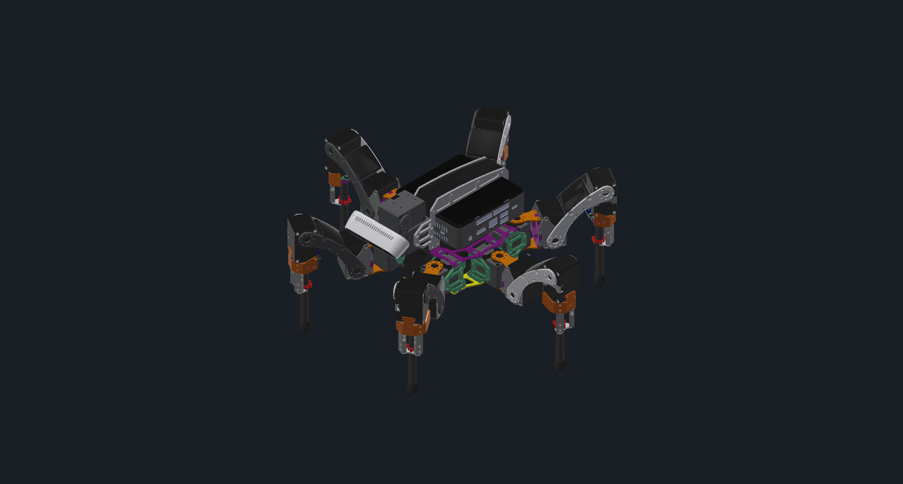
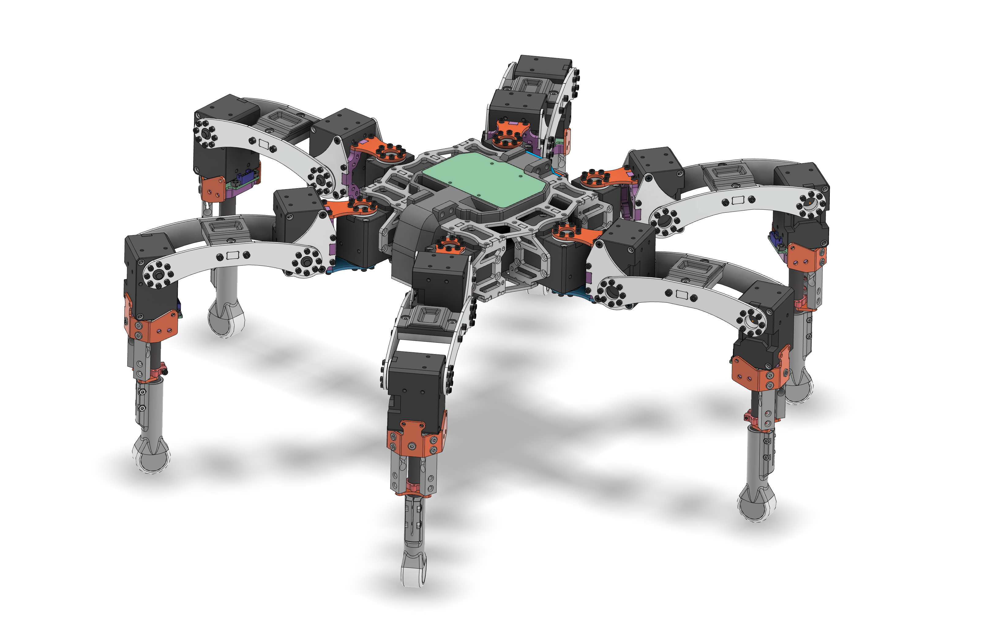

# hapthexa_hardware

Mechanical CAD models and PCB design data of the **HaptHexa** hexapod robot.

## About HaptHexa

HaptHexa is a six-legged walking robot built to walk on rough terrain. It was presented in the following paper:

> M. Cao, K. Yamashita, T. Kiyozumi and Y. Tada, "Hexapod Robot with Ground Reaction Force Sensor on Rough Terrain," *2021 IEEE International Conference on Mechatronics and Automation (ICMA)*, 2021.
> [IEEE Xplore](https://ieeexplore.ieee.org/document/9512603) · DOI: [10.1109/ICMA52036.2021.9512603](https://doi.org/10.1109/ICMA52036.2021.9512603)

The design rests on three ideas from the paper:

- **Six identical 3-DOF legs.** Each of the six leg units has three joints (coxa, femur and tibia), so the robot has 18 actuated joints in total.
- **A 3-axis ground reaction force sensor in every foot.** The sensor covers a hemispherical range, so it detects both ground contact (thrust load) and wall contact (radial load) regardless of the walking direction. This lets the robot feel the terrain at low cost and walk in any direction.
- **Posture control on rough terrain.** The robot combines the foot force sensors with an onboard gyro sensor to keep its body level while walking.

## Hardware revisions

| Revision | Directory | Actuators | Changes | Appearance |
|---|---|---|---|---|
| **R1** | [`2019_R1/`](2019_R1/) | 18 × DYNAMIXEL XL430-W250-T | First version. Mechanical CAD (Autodesk Inventor) and PCB designs (Autodesk EAGLE): main board and foot force sensor board. |  |
| **R2** | — | 18 × DYNAMIXEL XM430-W350-T | All motors replaced with XM430-W350-T. The design files are unchanged, so this revision has no directory of its own. | — |
| **R3** | [`2021_R3/`](2021_R3/) | 18 × DYNAMIXEL XM430-W350-T | Shorter toes. CAD structure reorganized and files renamed with a numbered part scheme. |  |

## Repository layout

```
2019_R1/
├── EAGLE/      PCB designs (schematics .sch, boards .brd, DXF outlines, Gerber order archives)
└── Inventor/   Mechanical CAD (parts .ipt, assemblies .iam, drawings)
2021_R3/
└── Inventor/   Mechanical CAD; top-level assembly: 00_000_HAPTHEXA_R3.iam
```

## License

[MIT License](LICENSE)
